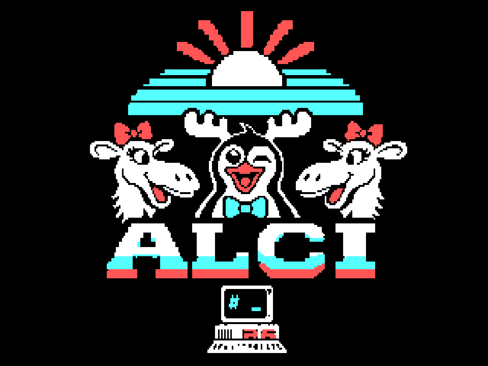

# ALCI: Asymmetric Linux Compact Initiative

  

**Alci** is an experimental branch of [ELKS](https://github.com/ghaerr/elks),
the Embeddable Linux Kernel Subset by Alan Cox, Greg Haerr and the ELKS team.
*Alci* is Italian for "elks". "Asymmetric" names the idea behind it: a
minimal machine on the desk, large services elsewhere (an 8088 at your
fingertips, a language model in the cloud).

Goals, in order:

1. A faster ELKS that uses as little memory as possible, on every PC from
   the 8088 to the 80386.
2. A graphical interface in the spirit of PC/GEOS.
3. A terminal for talking to Claude or other language models through a
   Wi-Fi modem on the serial port.

Alci keeps the processor support of ELKS: 8088, 8086, 80188, 80186, NEC
V20 and V30, 80286, and 80386 or later in real mode (486, Pentium and
newer PCs that boot from a legacy BIOS). What has actually been run so far:

| Processor | Where |
| --- | --- |
| 8088 | IBM XT (86Box), MartyPC |
| NEC V20 (80186 instruction set) | IBM XT (86Box) |
| 8086 | Toshiba T1200, Amstrad PC1512 (86Box) |
| 80286 | IBM AT (86Box) |
| 80386 | ECS 386 with AMI BIOS (86Box) |
| 80486 | QEMU |
| 80C188EB | builds; not yet run (no emulator for the board) |

No PC-compatible 80186 machine was available to emulate; the V20 runs the
same instruction set.

Measured on 2026-11-16, **ELKS 0.9.2 at commit
[`22a4c5d`](https://github.com/ghaerr/elks/commit/22a4c5d)** (ghaerr/elks
master of 2026-11-15) against **Alci 0.1 at commit
[`3ecae5b`](https://github.com/proxybarrio/alci/commit/3ecae5b)** (branch
`alci`). Both were built with the same configuration
([`alci/elks.config`](alci/elks.config)) and toolchain; `uname -a` in each
image reports its commit. Times are emulated seconds, ELKS / Alci; later
versions of either may give different results.

| Command | IBM XT, 8088 4.77 MHz, CGA | Toshiba T1200, 8086 9.54 MHz, LCD, internal disk | IBM AT, 286 8 MHz, EGA |
| --- | --- | --- | --- |
| `cat` of 200 lines to the screen (cached) | 20.57 / 1.89 | 7.46 / 0.68 | 4.46 / 0.34 |
| `ls -l /bin` to the screen (cached) | 30.71 / 10.69 | 11.38 / 4.00 | 5.78 / 1.77 |
| `ls -l /bin > /dev/null` (cached) | 16.68 / 9.45 | 6.28 / 3.53 | 2.64 / 1.53 |
| 10 runs of `pwd` | 2.79 / 1.75 | 0.98 / 0.62 | 0.41 / 0.29 |
| three-stage pipe, 48 KB | 10.22 / 3.07 | 3.80 / 1.11 | 1.60 / 0.47 |
| `grep` on 60 KB | 7.69 / 7.16 | 3.04 / 2.85 | 1.44 / 1.36 |

86Box 7.0 with each machine's real BIOS and its own display, hard disk.
Screen rows: commands typed on the emulated keyboard, time until the output
is complete on the screen. Other rows: serial console, output discarded.
On MartyPC (8088 4.77 MHz, CGA, 720K floppy) boot to the prompt with the
floppy rotation model takes 21.02 s on ELKS and 18.36 s on Alci. Full tables in
[`alci/RESULTS.md`](alci/RESULTS.md).

Since then (2026-11-19, Alci up to
[`70b577df`](https://github.com/proxybarrio/alci/commit/70b577df), each
change measured against the commit before it; details in
[`alci/RESULTS.md`](alci/RESULTS.md)):

- Programs on the floppies are compressed (LZSA1) and decoded by the
  kernel, and programs that exit stay in free memory until it is needed:
  the 720K system disk goes from 41 to 121 KB free, the first start of a
  program from the floppy is faster (`sed` 4.76 -> 3.19 s on the XT) and
  a second start is almost free (`vi` 4.75 -> 0.25 s). Cost: 1.9 KB of
  kernel memory.
- Network card drivers that find no card give their code back at boot:
  4.9 KB more free memory with no card, 3 KB with one.
- Serial input on the XT no longer loses characters (longest wait of a
  received byte about 640 -> 380 us); `clock -w` writes a valid year to
  the AT's CMOS after 1999; programs no longer fail for lack of memory
  when several start at once on a 512K AT.
- Floppy boot to `login:` 22.81 -> 22.21 s on the XT (the boot loader no
  longer reads the same block twice).
- When the date is older than the system (an XT with no clock), it is
  asked at boot; no answer, and the boot goes on after 60 s.

Since then (up to 2026-11-27):

- **A graphical desktop.** [Contiki 1.x](https://github.com/adamdunkels/contiki-1.x)'s
  CTK desktop, ported to Alci and redrawn: windows with title bars and
  close boxes, menus, dialogs and icons, with a file manager, a text
  editor, up to three shell windows, a calculator and an About box. Type
  `desk`: it asks the video BIOS and starts the build for the screen,
  one program per screen type (CGA two and four colours, EGA and VGA in
  colour and monochrome, MCGA, Hercules, Tandy 1000 and PCjr, AT&T 6300,
  Toshiba T1200 LCD), each about 40 KB on disk. Details in
  [`alci/contiki/README.md`](alci/contiki/README.md).
- **Mouse and keyboard as on Windows and Xfce.** Microsoft serial mouse,
  or the pointer from the keyboard; Alt+Tab (hold Alt to see the open
  windows), Alt+Esc, Alt+F4 (on an empty desktop it asks to leave),
  Alt+Space for the window menu, the Windows key for the main menu.
  Windows are moved by copying them in video memory.
- **Fast on the 8088.** On an IBM XT at 4.77 MHz a quick Alt+Tab to the
  full-screen editor takes 0.16 s on CGA and 0.32 s on EGA (1.48 s and
  3.42 s with the original CTK drawing): text drawn straight into video
  memory, less drawn again, and the windows behind kept as a hidden copy
  (in the spare video memory of EGA, VGA and Hercules, in far memory on
  CGA). Compared with Nano-X and GEM on the same machine
  ([GUI benchmark](alci/RESULTS.md#gui-benchmark-task-d2-martypc-2026-11-27)),
  CTK starts in 4.4 s from the floppy and opens a window in 0.14 s.
- The disk activity wheel of the text screen no longer draws into a
  graphics screen; ELKS master of 2026-11-25 merged.

A demonstration video (IBM XT, colour CGA, at real speed from the floppy)
is attached to the
[0.2 preview release](https://github.com/proxybarrio/alci/releases).

Every change is a separate commit on branch `alci`, measured on the
cycle-accurate MartyPC emulator and checked for identical behaviour on six
86Box machines (8088, V20, 8086, 286, 386) and QEMU. Details:

- [`alci/README.md`](alci/README.md): what Alci is and how the work is organised.
- [`alci/RESULTS.md`](alci/RESULTS.md): measurements and memory cost of every change.
- [`alci/TASKS.md`](alci/TASKS.md): the roadmap.
- [`alci/tests/`](alci/tests/): functional and speed tests on QEMU and 86Box.

Changes are developed with the help of Claude (Anthropic). Changes that
may be useful to ELKS in general are shared with the ELKS project
regularly, for its maintainers to consider.

---

*The original ELKS README follows.*

  <picture>
    <source media="(prefers-color-scheme: dark)" srcset="./Documentation/img/ELKS-Logo-dark.svg">
    <source media="(prefers-color-scheme: light)" srcset="./Documentation/img/ELKS-Logo-light.svg">
    
  </picture>

# What is ELKS?

ELKS is a project providing an early fork of the Linux OS for systems based on the Intel
IA16 architecture (16-bit processors: 8086, 8088, 80188, 80186, 80286, NEC V20, V30
and compatibles). Such systems can be ancient computers (IBM-PC XT / AT and clones)
as well as more recent SBCs, SoCs, FPGAs, as well as modern 80386+ x86 desktops.
ELKS supports networking, graphics, ia16-elf-gcc, OpenWatcom C and its own native
C compiler, and installation to HDD using both MINIX and MSDOS FAT filesystems.

## Memory requirements

* Stock images require 512k RAM
* ELKS requires 256k RAM to run, 512k to be really useful
* No hardware MMU required
* ROM-based systems can run in 128k RAM

## Try ELKS online
You can [play with ELKS online](https://copy.sh/v86/?profile=elks) thanks to the v86 emulator. Login with "root" and no password. Go to the bin folder and try the different commands available. Try nxtetris. Start the game by pressing "n".
  
## Watch ELKS in action

- [Can an IBM PC Portable Run Linux with Ethernet?](https://www.youtube.com/watch?v=tN7DgIWkdTo) (thanks The Phintage Collector)
- [ELKS 0.9.1 and Nano-X on a 286](https://www.youtube.com/watch?v=FM1HRQYnvJk) (thanks Clean Retro Tech)
- [This Floppy Disk is a WEB SERVER](https://www.youtube.com/watch?v=efglR_2Hy4Y) (thanks Action Retro)
- [ELKS, a 16-bit no-MMU Linux on Amstrad PC 2086](https://www.youtube.com/watch?v=eooviN1SdQ8) (thanks @pawoswm-arm)
- [Booting ELKS on an old 286 MB from 1,44MB floppy](https://www.youtube.com/watch?v=6rwlqmdebxk) (thanks @xrayer)
- [Epson PC Portable Q150A / Equity LT (Nec V30 8086 - 1989)](https://youtu.be/ZDffBj6zY-w?t=687) (thanks Alejandro)
- [ELKS on ESP32 through IBM PC emulator](https://www.youtube.com/watch?v=Tr2yMjrgP8o) (thanks @fdivitto)

## Screenshots

ELKS running on QEMU

Nano-X running on ELKS

Olivetti M24 8086 CPU

ELKS Networking showing netstat and process list

Running ELKS Basic on PC-9801UV21 (NEC V30 CPU)

Running Matrix and vi on multiple consoles

Of course Doom

Telnet to an old BBS

## Downloads

A full set of disk images are available for download, for you to try out ELKS: [Downloads](https://github.com/ghaerr/elks/releases).

## How to build

Full build instructions are [here](https://github.com/ghaerr/elks/blob/master/BUILD.md).

## Wiki

Help on how to use ELKS, as well as technical tutorials, are available on our [Wiki](https://github.com/ghaerr/elks/wiki).

## Documentation

More information is in the Documentation folder: [Index of ELKS Documentation](https://htmlpreview.github.io/?https://github.com/ghaerr/elks/blob/master/Documentation/index.html).

## Resources

Other projects and resources interesting to ELKS and our programming community:

- [8086 toolchain](https://github.com/ghaerr/8086-toolchain) A full C toolchain capable of running on Linux, macOS and natively on ELKS, featuring C compiler
and preprocessor, as86 assembler, ld86 linker, disassembler, make, and a complete C library.
- [blink16](https://github.com/ghaerr/blink16) A visual 8086 emulator and debugger capable of booting the ELKS kernel for symbolic debugging, as well as an emulator for ELKS executables.
- [Size Optimization Tricks](https://justine.lol/sizetricks/) A great article from Justine Tunney's blog showing how big things can be done without bloat.
- [gcc-ia16](https://github.com/tkchia/gcc-ia16) TK Chia's gcc compiler targeted for 8086, maintained and used for the ELKS kernel and all its applications.

## More information

Questions? Problems? Patches? Open an issue on the ELKS GitHub project!
