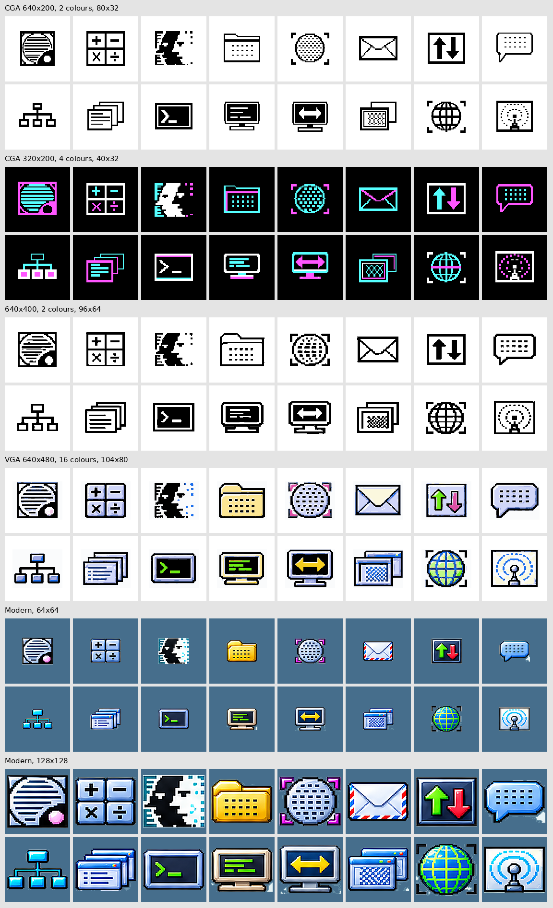

# Alci desktop icons

Icons for the 16 programs of the Contiki 1.x desktop, one set for each
screen family (see `alci/docs/screens.md` for the pixel shapes). On the
8088 the icons keep the idea of the Contiki originals, only cleaner; the
stronger the screen, the more refined the drawing, with the same idea.

## Sets

| Set | Screen | Icon size | Colours | Bytes per icon | Whole set (`.ais`) |
| --- | --- | --- | --- | --- | --- |
| `cga640-mono` | CGA 640x200 (also EGA and VGA in that mode) | 80x32 pixels, 10x4 cells of 8x8 | 2 | 320 | 5,332 |
| `cga320-4col` | CGA 320x200, palette 1, high intensity | 40x32 pixels, 5x4 cells of 8x8 | 4: black, cyan, magenta, white | 320 | 5,338 |
| `hires640x400-mono` | 640x400 (Olivetti M24, AT&T 6300, Toshiba T3100, Quaderno) | 96x64 pixels, 12x4 cells of 8x16 | 2 | 768 | 12,500 |
| `vga640-16col` | VGA 640x480, 16 colours | 104x80 pixels | 16, palette of its own (the VGA DAC is reprogrammed) | 4,160 | 66,814 |
| `modern-64`, `modern-128` | modern PCs | 64x64, 128x128 | full colour, transparent background (PNG) | | |

The two CGA sets are drawn by hand, pixel by pixel (`src/cga/`). The
640x400 and VGA sets are cleaned conversions of the same design sheet, the
modern sets are taken from it at full colour. Still to draw: the Hercules,
EGA 640x350 and Toshiba T1200 LCD families (medium pixel shape).

The names are those of the Contiki programs: `about`, `calculator`,
`dhcp`, `directory`, `editor`, `email`, `ftp`, `irc`, `netconf`,
`processes`, `shell`, `telnet`, `telnetd`, `vnc`, `www`, `webserver`.

## Where they go

- Built into the desktop: the default set of the machine's family is
  compiled in from `out/<set>.h` (static arrays, sizes as `#define`s).
- Installed later: the other sets are single files, `out/<set>.ais`, that
  ept installs on request (planned place on disk: `/lib/icons/`), like the
  display drivers of old Windows. A boot disk carries only its family.

## Formats

`out/<set>.h` and `out/<set>.ais` hold the same bitmaps.

- Cell layout (the CGA and 640x400 sets): the icon is cut into text cells,
  stored left to right, top to bottom; inside a cell one byte per pixel row
  at 1 bit per pixel, two bytes at 2 bits per pixel, leftmost pixel in the
  most significant bits. This is the order the CTK drawing layer writes to
  video memory, so a cell is copied as it is. At 1 bit per pixel, 1 is ink
  and 0 is paper, as in the theme patterns of `ctk-cga.c`. At 2 bits per
  pixel the values are the CGA palette 1 colours: 0 black, 1 cyan,
  2 magenta, 3 white.
- Row layout (the VGA set): plain rows, 4 bits per pixel, two pixels per
  byte, left pixel in the high nibble. The palette is given as 8-bit RGB;
  divide by 4 for the VGA DAC.

`.ais` file, little endian:

| Field | Size |
| --- | --- |
| magic `AIS1` | 4 |
| bits per pixel | 1 |
| cell width, cell height (0, 0 for the row layout) | 1 + 1 |
| palette entries | 1 |
| icon width, icon height in pixels | 2 + 2 |
| number of icons | 1 |
| paper (background) colour index | 1 |
| palette, R G B per entry | 3 each |
| per icon: name, zero padded, then the bitmap | 12 + bitmap |

## Rebuilding

    python3 src/cga/render.py png        # the two hand-drawn CGA sets
    python3 tools/mkicons.py png out     # .h and .ais from the PNGs
    python3 tools/preview.py png preview.png

The scripts need Python 3 with Pillow and NumPy. Each CGA icon is a short
function in `src/cga/mono.py` (640x200) or `src/cga/col.py` (320x200) that
places rectangles, lines, ellipses and single pixels; change a number,
render again. The 640x400, VGA and modern sets are edited as PNG files
(indexed PNG for 640x400 and VGA, keeping their palettes).
