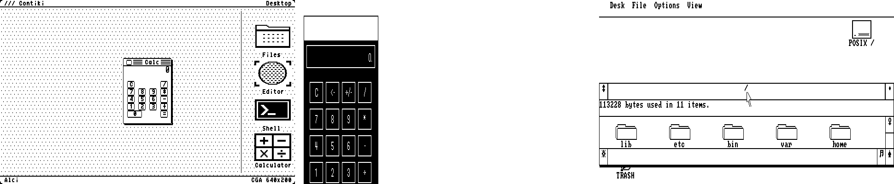

# GUI study: Contiki CTK, Nano-X and Gem-elks on the 8088 (task D2)

The three candidates for the base of the Alci desktop, measured the same
way (`alci/tests/guibench`) on MartyPC, an IBM XT (8088 at 4.77 MHz,
640 KB) booting Alci from a 720K floppy, with CGA (the reference) and
with EGA. The numbers are in `alci/RESULTS.md` ("GUI benchmark, task
D2"); this page sums them up and shows the screens. The choice of base is
the maintainer's.

*CGA 640x200, from the left: CTK with its calculator, Nano-X with
nxcalc (drawn for 640x480, so it is cut at the bottom and its title bar
is grey dithered to white), Gem-elks with a folder window.*

## In short

| CGA, 8088 4.77 MHz | Contiki CTK | Nano-X | Gem-elks |
|---|---|---|---|
| Disk, plain / packed | 50 / 39 KB | 73 / 42 KB (server) | 292 / 226 KB |
| Memory of the desktop | 78 KB | 90 KB (server) + 23 KB per client | about 300 KB |
| Left for a program | about 270 KB | about 255 KB | about 40 KB, largest block 4 KB |
| Start from the 720K floppy | 4.4 s | 6.6 s (server only) | 17.6 s |
| Window opened | 0.21 s | 2.2 s | 4.7 s |
| Window moved | 0.18 s | 0.84 s | 4.4 s |
| A line of text | 0.03 s | 0.45 s | 3.1 s |
| A window of text | 0.21 s (14 rows) | 4.2 s (10 rows) | 19.3 s (7 rows) |
| One character | 0.02 s | 0.06 s | 0.9 s |

## Contiki CTK

The smallest and the quickest at drawing text, by fifteen to thirty times
over Nano-X and a hundred or more over GEM: its windows are cells of the 8x8 font, and a label
is drawn as whole bytes. It is one process: the desktop, its programs
(editor, shell, file manager, calculator) and the drawing all live in it,
so a program for it is built in, and only one desktop runs at a time.
It moves a window as Nano-X does, by copying it in video memory and
drawing only the desktop it uncovers: 0.18 s on CGA and 0.47 s on EGA,
against 0.84 s and 1.0 s for Nano-X (before, it drew the whole screen
again: 1.1 s and 2.5 s).

## Nano-X

A server with a window manager inside, and clients over a local socket;
each client is a separate program of about 20 KB, so programs can be
added without touching the server. Opening, moving and drawing text are slower
than CTK (with its fixed 6x13 font), and
closing is the quickest of the three (the server only paints the
background back). Its demos are drawn for 640x480: on CGA nxcalc does not
fit; and the CGA driver needed a missing `<stddef.h>` to build.
The server leaves when its last client does. Its client library for ELKS
lacks `GrInjectKeyboardEvent`, so the response to a key could not be
measured the same way as the others; "one character" stands in for it.

## Gem-elks

The look and the programs of GEM (desktop, file windows, menus, the
calculator and the clock), with a resident AES/VDI server and programs
as separate processes. On a 640 KB 8088 it is at the edge:

- With the desktop up, about 40 KB are left and the largest free block
  is 4 KB: no other program can be started, not even `kill` from a
  script. The benchmark's own client had to be started before GEM.
- It is six times slower than CTK at opening a window and about
  seventy times slower at a line of text (GEM's text goes through the VDI, glyph
  by glyph, on the 8088).
- It does not start on a CGA machine as published: it asks the BIOS for
  the 8x8 font with INT 10h AX=1130h, which only EGA and VGA BIOSes
  have. The fix is four lines (`tests/guibench/gem-elks-cga-font.patch`),
  but the server's code is already at the 128 KB of the medium model and
  passes it by 32 bytes with them: the CGA numbers come from a build
  without the Amstrad mouse driver.
- The server does not stop on SIGTERM; after a SIGKILL it did not start
  again in the same boot; `v_clsvwk` and `appl_exit` did not return on
  the 8088; the first program to connect takes the desktop's channel.

These are worth reporting to its author (its README names an Amstrad
PC1640, an 8086 with EGA, as its test machine).

## What is not measured yet

Start from a 1.44M floppy and from the hard disk, start times of the
packed programs, the 86Box PC1512 and AT, and the response to a real key
press for Nano-X and GEM. CTK's own response to a key in its editor is
57 ms on CGA (`alci/contiki/README.md`).
